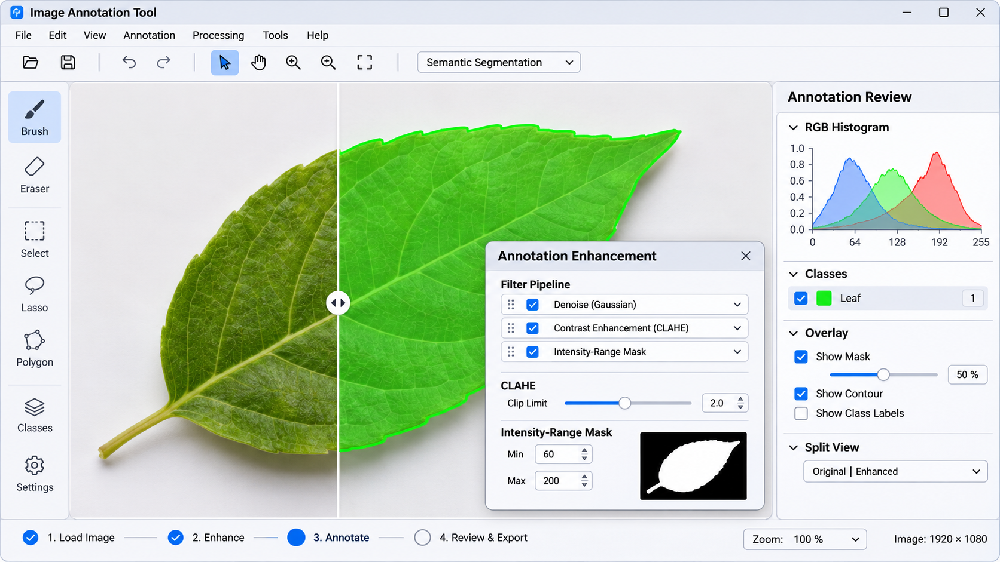

# Semantic Mask Tools

This fork provides an editable semantic-segmentation workflow alongside the
standard LabelMe shapes. These tools create ordinary `mask` annotations, so the
existing JSON save format and downstream mask exports continue to work.

## Brush and Eraser

Choose **Brush** from Shape Tools. LabelMe asks for the class before the first
stroke, then paints a live mask preview at the selected brush size (10 px by
default). Strokes of the same class merge when their painted pixels overlap or
touch. **Eraser** removes mask pixels using the same size control.

Right-click a selected, unlocked mask in the Shape List to use:

- **Smooth Mask Borders** — applies gentle pixel-based smoothing to jagged
  edges.
- **Fill Mask Holes** — fills enclosed background holes in the mask.

## Annotation Enhancement

**Annotation Enhancement** changes only the display preview; it never replaces
the source image or image data saved with an annotation. Its filter pipeline can
combine and reorder CLAHE, auto contrast, sharpen, edge enhancement, Canny
overlay, unsharp mask, adaptive threshold, Sobel gradient, Frangi/vesselness,
and LAB-channel views. Select a pipeline entry to expose its parameters.

The dialog remembers its settings per image. Use **Restore Defaults** to clear
filters and return the display preview to the original image.

## Review tools

The Annotation Review panel above Shape List provides original/enhanced and
without-mask/with-mask split views. Drag the divider to inspect alignment. Turn
on **Show histogram** only when you need RGB intensity distributions.

## Classical Segmentation

Inside Annotation Enhancement, enable **Preview grayscale intensity range**.
The selected range is calculated after the ordered filter pipeline, allowing
preprocessing to improve a thresholding result. Click **Create Editable Mask**,
choose a label, and refine the new semantic mask with the Brush and Eraser.

## Attribution

The semantic-mask, annotation-enhancement, and review workflow in this fork was
developed by **Mohammad Zakaria Rajabi**.
